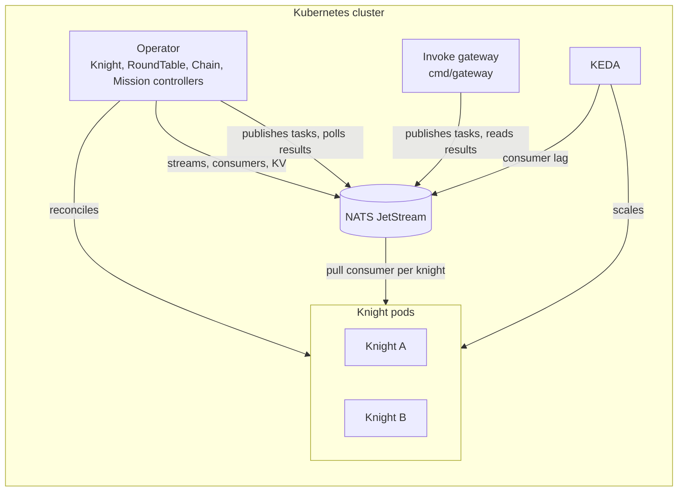
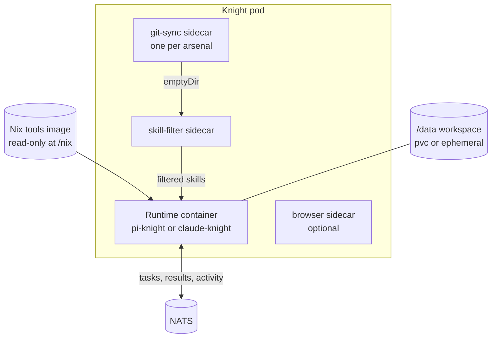
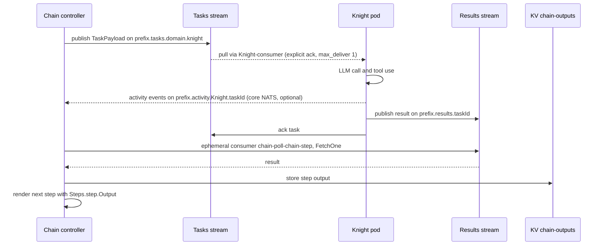
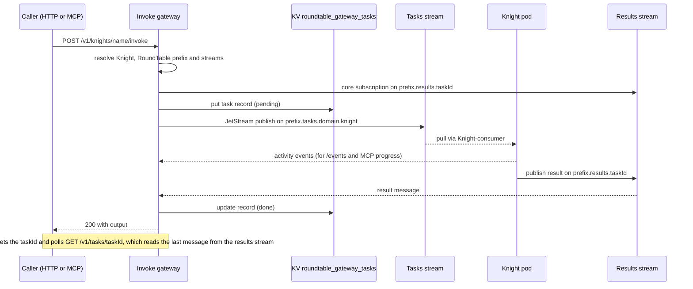

# Architecture

> How the system runs today. Three parts: [NATS/JetStream topology](#natsjetstream-topology), [the knight environment](#the-knight-environment) and [request flow](#request-flow). Design records for individual features are linked where they apply.

## Overview

**Knights of the Round Table** is a Kubernetes operator that orchestrates fleets of AI agents as first-class cluster resources. It provides declarative management, workflow orchestration, and cost control through four Custom Resource Definitions.

| Concept | Kubernetes Resource | Purpose |
|---------|-------------------|---------|
| **Knight** | Deployment (or agent-sandbox Sandbox) + pod | A single AI agent with a domain, model, skills and tools |
| **RoundTable** | Fleet config | A group of knights sharing NATS infrastructure and policies |
| **Chain** | DAG workflow | Multi-step task pipeline with output chaining between knights |
| **Mission** | Ephemeral team | Auto-assembles knights for a time-bounded objective |



## NATS/JetStream topology

All names come from `pkg/nats`, `internal/deadletter` and the RoundTable reconciler (`internal/controller/roundtable_controller.go`, `ensureStreams`). `<prefix>` is `spec.nats.subjectPrefix` of the RoundTable.

### Streams

| Stream | Subjects | Retention | Created by |
|---|---|---|---|
| Tasks stream, `spec.nats.tasksStream` | `<prefix>.tasks.>` | `spec.nats.streamRetention` (default WorkQueue), file storage | RoundTable controller (`ensureStreams`), when `spec.nats.createStreams` is true |
| Results stream, `spec.nats.resultsStream` | `<prefix>.results.>` | same as tasks | same |
| Events stream, `spec.nats.eventsStream` (default `<tasksStream>_EVENTS`) | `<prefix>.events.>` | Limits with a max age (`EventsRetention()`); read by NATS-source Triggers | same, skipped for ephemeral (Mission) tables |
| Advisories stream `<tasksStream>_ADVISORIES` | JetStream max-deliveries advisories for the tasks stream | Limits | RoundTable controller (dead-letter manager, `deadletter.AdvisoriesStreamName`) |
| Dead-letter stream `<tasksStream>_DLQ` | `<prefix>.dlq.>` | Limits, max age `spec.nats.deadLetterMaxAge` | same (`deadletter.StreamName`) |

Task activity events are published on plain NATS (no stream captures them); see below.

### Subjects

| Subject | Publisher | Reader | Source |
|---|---|---|---|
| `<prefix>.tasks.<domain>.<knight>` | Chain/Mission controllers, invoke gateway | the knight's consumer | `natspkg.TaskSubject` |
| `<prefix>.results.<taskId>` | the knight runtime | Chain/Mission controllers (JetStream consumer), invoke gateway (core subscription plus `GetLastMsg`) | `natspkg.ResultSubject` |
| `<prefix>.activity.<Knight>.<taskId>` | the knight runtime | gateway (`/events` streams, MCP progress), UI | `natspkg.ActivitySubject`; [design](design/task-activity-events.md) |
| `<prefix>.events.<name>` | anything | NATS-source Triggers | `natspkg.EventSubject` |
| `<prefix>.events.github.<namespace>.<name>` | the Trigger controller's GitHub poll loop | that github-source Trigger | `natspkg.GitHubEventSubject` |
| `<prefix>.dlq.<knight>.<taskId>` | operator dead-letter watcher | `GET /v1/dead-letters` | `deadletter.Subject` |

### Consumers

| Consumer | On | Owner |
|---|---|---|
| `<Knight>-consumer` (`natspkg.KnightTaskConsumerName`) | tasks stream | Knight controller; durable, pull |
| `chain-poll-<chain>-<step>` (`natspkg.ChainConsumerName`) | results stream | Chain controller; ephemeral, deleted after the read |
| `roundtable-dead-letter` (`deadletter.ConsumerName`) | advisories stream | RoundTable controller (dead-letter manager) |
| `trigger-<namespace>_<name>` (`natspkg.TriggerConsumerName`) | events stream | Trigger controller |

### KV buckets

| Bucket | Holds | Source |
|---|---|---|
| `chain-outputs` | Chain step outputs, read back for fan-out, loops and large outputs | `internal/controller/chain_outputs.go` |
| `mission-results` | Retained Mission results (TTL `ResultsTTL`, default 30 days) | `natspkg.ResultsBucket` |
| `roundtable-cards` (override: env `CARDS_KV_BUCKET`) | Knight agent cards, one entry per knight | `natspkg.DefaultCardsBucket`, [agent-cards.md](agent-cards.md) |
| `roundtable-dead-letters` | Dead-letter entry state, key `<table>.<taskId>` | `deadletter.KVBucket` |
| `roundtable_gateway_tasks` (chart value `gateway.taskBucket`) | Invoke gateway task records | `charts/roundtable-operator/values.yaml` |

### Consumer model

Each knight reads its tasks from a **durable JetStream pull consumer**
`<Knight>-consumer` (the Knight name capitalised) on `spec.nats.stream`:

- Filter subjects: `spec.nats.subjects`
- Explicit ack, deliver all, `max_deliver: 1` (at most once; no automatic redelivery), 30 s `ack_wait` (a heartbeat window; running tasks send in-progress acks)
- Lost and failed tasks go to the dead-letter stream and are retried by hand (see [knight-task-contract.md](knight-task-contract.md#delivery-and-failure))

KEDA scales the knight on this consumer's lag, so its name and config do not
change. The values live in one place, `natspkg.KnightTaskConsumerConfig`
(`pkg/nats/consumer.go`), copied from the runtimes' `subscribe()` in
roundtable-k8s/knights `packages/core/src/nats/index.ts`.

### JetStream topology: who owns what

| Object | Owner | Lifecycle |
|--------|-------|-----------|
| Tasks, results, dead-letter and advisories streams | RoundTable controller (when `spec.nats.createStreams` is true) | Created with the table |
| Knight task consumer `<Knight>-consumer` | **Knight controller** | Created when the Knight is reconciled, so it exists while the knight is scaled to zero or suspended; deleted by the Knight's finalizer |
| Dead-letter consumer `roundtable-dead-letter` | RoundTable controller (dead-letter manager) | With the dead-letter stream |
| Result poll consumers (`chain-poll-*`, mission planners) | Chain and Mission controllers | Ephemeral: deleted after the result is read |
| Agent cards KV bucket | RoundTable controller (entries also dropped by the Knight finalizer) | Per knight entry |

The Knight controller reconciles the task consumer on every reconcile:

- **Missing**: created.
- **Matches** (for example one a runtime created first): adopted as it is, never
  rewritten, so tasks in flight and the delivery state are kept.
- **Filters, `ack_wait` or `max_deliver` differ**: updated in place.
- **A field NATS cannot update differs** (deliver, ack or replay policy, start
  sequence or time, push instead of pull): deleted and recreated, with a
  `ConsumerRecreated` Warning event. Only then is the consumer's state lost.

The `ConsumerReady` condition on the Knight and the gauge
`roundtable_knight_consumer_ready{table,knight}` (1 or 0) report the result;
`ConsumerReady=False` carries `NATSUnavailable`, `StreamNotFound` or
`ConsumerFailed` and is retried every 30 s. It does not fail the rest of the
reconcile. Without a NATS connection configured the operator leaves consumers
alone.

When a Knight is deleted, its finalizer deletes the consumer. If NATS is
unreachable it retries every 10 s for up to 5 minutes, then gives up with a
`ConsumerDeleteAbandoned` Warning event naming the consumer to delete by hand
(`nats consumer rm <stream> <Knight>-consumer`), so an outage never blocks the
deletion.

The runtimes still create the consumer at start-up with the same config until
they only bind to it (roundtable-k8s/knights follow-up). Because both sides
produce the same config, neither rewrites the other's consumer.


## The knight environment

One Knight resource becomes one Deployment (default) or Sandbox plus its supporting objects. The pod is assembled in `internal/knight/pod_builder.go`; the backend is picked with `spec.runtime`.

```go
type RuntimeBackend interface { // pkg/runtime/backend.go
    Reconcile / Cleanup / IsReady / Suspend / Resume
}
```

- **DeploymentBackend** (`deployment_backend.go`): a Kubernetes Deployment.
- **SandboxBackend** (`sandbox_backend.go`): the `agents.x-k8s.io` Sandbox CRD; suspends and resumes through `spec.operatingMode`.

Why two backends and what was rejected: [design/runtime-backends-adr.md](design/runtime-backends-adr.md).



| Part | How it is built |
|---|---|
| **Runtime image** | `spec.image` selects the runtime: pi-knight or claude-knight (roundtable-k8s/knights). The operator sets `KNIGHT_NAME` (capitalised Knight name), `KNIGHT_MODEL`, `KNIGHT_EFFORT`, `NATS_URL`, `NATS_TASKS_STREAM`, `NATS_RESULTS_STREAM`, `NATS_RESULTS_PREFIX`, `SUBSCRIBE_TOPICS` (from `spec.nats.subjects`), `MAX_CONCURRENT_TASKS`, `TASK_TIMEOUT_MS`, `ROUNDTABLE_TABLE`, `KNIGHT_CARDS_BUCKET`, `KNIGHT_WORKSPACE_MODE`, `KNIGHT_MEMORY_DIR`/`KNIGHT_MEMORY_ROOT` ([memory.md](memory.md)), `ACTIVITY_CONTENT`, `METRICS_PORT`, `LOG_LEVEL`, `TZ` and the OpenTelemetry variables (`OTEL_EXPORTER_OTLP_ENDPOINT`, `OTEL_RESOURCE_ATTRIBUTES`, `OTEL_SDK_DISABLED`, `ROUNDTABLE_TELEMETRY_CAPTURE_CONTENT`). |
| **Skills** | `spec.arsenals`: one git-sync sidecar per arsenal (`GITSYNC_REPO`, `GITSYNC_REF`, `GITSYNC_ROOT`, `GITSYNC_LINK`, `GITSYNC_PERIOD`) syncs into an emptyDir. The `skill-filter` sidecar copies only the categories in `SKILL_CATEGORIES` into the skills directory the runtime reads. |
| **Tools** | `spec.tools.nix` and `spec.tools.flakes` are built into a tools image (nix2container, tag = hash of the tool set; `internal/knight/tools_image.go`, `internal/controller/knight_toolsimage.go`), recorded in `status.toolsImage` and mounted read-only at `/nix`. The pod's PATH uses `/nix/profile/bin` (`KNIGHT_NIX_PROFILE`). Needs the chart value `toolsImage.repository`. |
| **Workspace** | `spec.workspace.mode`: `pvc` (default; one ReadWriteOnce PVC at `/data`, or `existingClaim`) or `ephemeral` (per-pod emptyDir at `/data`, size limit `size`). More than one replica needs `ephemeral` or a shared claim. |
| **Scaling** | `spec.replicas` / `spec.maxReplicas` and `lifecycle.suspendPolicy: auto` make the operator render a KEDA ScaledObject (`internal/controller/knight_scaling.go`) with a `nats-jetstream` trigger on the knight's `<Knight>-consumer`, `lagThreshold: 1`. Without KEDA the knight runs at a fixed replica count. |
| **Pod security** | Pod: `runAsUser/Group` and `fsGroup` 1000 by default (env `KNIGHT_RUN_AS_USER`, `KNIGHT_RUN_AS_GROUP`, `KNIGHT_FS_GROUP`, `KNIGHT_FS_GROUP_CHANGE_POLICY` on the operator). Containers: `RestrictedContainerSecurityContext` (no privilege escalation, non-root, drop `ALL`, `RuntimeDefault` seccomp). `spec.runtimeClassName` / `spec.isolation` pick gVisor and egress rules ([runtime-isolation.md](runtime-isolation.md), [egress.md](egress.md)). |

## Request flow

### Chain step

The Chain controller renders the step prompt, publishes a task, then polls for the result on every reconcile. It never holds a connection open for the duration of the task.



Sources: `internal/controller/chain_dispatch.go` (publish), `chain_results.go` (`ChainConsumerName`, `FetchOne`), `chain_outputs.go` (`KVPut` to `chain-outputs`).

### Invoke gateway call

The gateway ([gateway.md](gateway.md)) is a separate Deployment built from the operator image. It publishes the same `TaskPayload` and returns the answer in the HTTP response, or a task ID to poll if the wait runs out.



Sources: `internal/gateway/service.go` (`Invoke`: `Watch`, `PutRecord`, `Publish`), `internal/gateway/bus.go` (`LastResult`).

## Mission Lifecycle

```
Pending → Provisioning → Planning → Assembling → Briefing → Active → Succeeded/Failed → CleaningUp
```

| Phase | What Happens |
|-------|-------------|
| **Pending** | Validate spec, set initial status |
| **Provisioning** | Create ephemeral RoundTable + NATS streams |
| **Planning** | (meta-missions) Dispatch to planner knight, receive Chain definitions |
| **Assembling** | Create mission knights, wait for Ready |
| **Briefing** | Publish mission context to all knights via NATS |
| **Active** | Execute chains, track costs, monitor timeout |
| **CleaningUp** | Delete ephemeral resources, preserve results if configured |

## Mission Knights

The assembler creates each ephemeral mission knight directly as `<mission>-<knight>`, owned by the Mission, so deleting the mission deletes the knight. Every mission knight carries the annotation `ai.roundtable.io/shutdown-time`: the mission's expiry (`status.expiresAt`, start + `ttlSeconds`). A knight whose template says `runtime: sandbox` is one bare agent-sandbox `Sandbox`, and the Sandbox backend copies that annotation into the Sandbox's `spec.shutdownTime`, so its pod stops at the mission's expiry even if cleanup never runs. Mission knights always start cold.

There is no warm pool: `RoundTable.spec.warmPool` was removed in #483 because it never reused a running pod. Warm starts will come back through upstream agent-sandbox pools (`SandboxTemplate` + `SandboxWarmPool`) if the cold-start spike in #368 supports them.

## Chain Execution

Chains are multi-step DAG workflows with Go template output chaining:

```yaml
steps:
  - name: scan
    knightRef: {name: galahad}
    prompt: "Scan for CVEs"
  - name: report
    knightRef: {name: kay}
    prompt: "Summarize: {{ .Steps.scan.Output }}"
```

Steps execute in dependency order. Independent steps run in parallel. Each step's output is available to subsequent steps via `{{ .Steps.<name>.Output }}`.

## Cost Tracking

Costs tracked at three levels:
- **Per-knight**: `status.totalCost` (lifetime)
- **Per-mission**: `status.totalCost` (mission duration)
- **Per-RoundTable**: aggregated across all knights

Budget enforcement: `spec.policies.costBudgetUSD` triggers OverBudget phase when exceeded.

## Operator Metrics

All operator metrics follow the `roundtable_*` scheme and, except the per-knight wake histogram, carry the `table` label. The gauges are recomputed from the Knight and Mission lists on each RoundTable reconcile.

| Metric | Type | Labels |
|---|---|---|
| `roundtable_knights` | gauge | `table`, `phase` |
| `roundtable_missions` | gauge | `table`, `phase` |
| `roundtable_table_cost_usd` | gauge | `table` |
| `roundtable_knight_isolated` | gauge | `table`, `knight`, `reason` (1 for the current `Isolated` condition reason) |
| `roundtable_knight_consumer_ready` | gauge | `table`, `knight` (1 when the knight's task consumer exists with the expected config, else 0) |
| `roundtable_chain_runs_total` | counter | `table`, `chain`, `status` (`succeeded`, `partially_succeeded`, `failed`) |
| `roundtable_chain_noop_runs_total` | counter | `table`, `chain` |
| `roundtable_chain_step_duration_seconds` | histogram | `table`, `chain`, `step`, `status` |
| `roundtable_chain_provider_retries_total` | counter | `table`, `chain`, `step`, `reason` |
| `roundtable_knight_wake_seconds` | histogram | `table`, `knight`, `namespace` |
| `roundtable_tasks_dead_lettered_total` | counter | `table`, `knight`, `reason` |
| `roundtable_dead_letters_open` | gauge | `table`, `knight` |
| `roundtable_trigger_firings_total` | counter | `table`, `trigger`, `source` (`schedule`, `nats`, `webhook`, `github`), `outcome` (`started`, `deduped`, `skipped`, `error`) |
| `roundtable_trigger_last_fired_timestamp_seconds` | gauge | `table`, `trigger` |

The invoke gateway serves its own metrics (`--metrics-listen`, chart: `metrics.enabled`) on a separate, unauthenticated port:

| Metric | Type | Labels |
|---|---|---|
| `roundtable_gateway_requests_total` | counter | `route` (registered route template, `unmatched` otherwise), `code`, `table` (`none` when the request names no knight, chain or Trigger), `caller_kind` (`serviceaccount`, `token`, or `none` for refused and webhook requests; never the caller's name) |
| `roundtable_gateway_request_duration_seconds` | histogram | `route` |

A Trigger's `table` is its target chain's `roundTableRef` (the Trigger's own, then `none`, if unset).

Knight pods carry `ROUNDTABLE_TABLE=<table>` (empty without a table) and the `ai.roundtable.io/round-table` pod label.

## Directory Structure

```
api/v1alpha1/           — CRD type definitions
internal/controller/    — Reconcilers (one per CRD)
internal/mission/       — KnightAssembler, mission lifecycle helpers
pkg/runtime/            — RuntimeBackend interface + implementations
pkg/nats/               — JetStream client wrapper
charts/roundtable-operator/ — Helm chart
examples/               — Real-world manifest examples
docs/                   — Documentation
```
